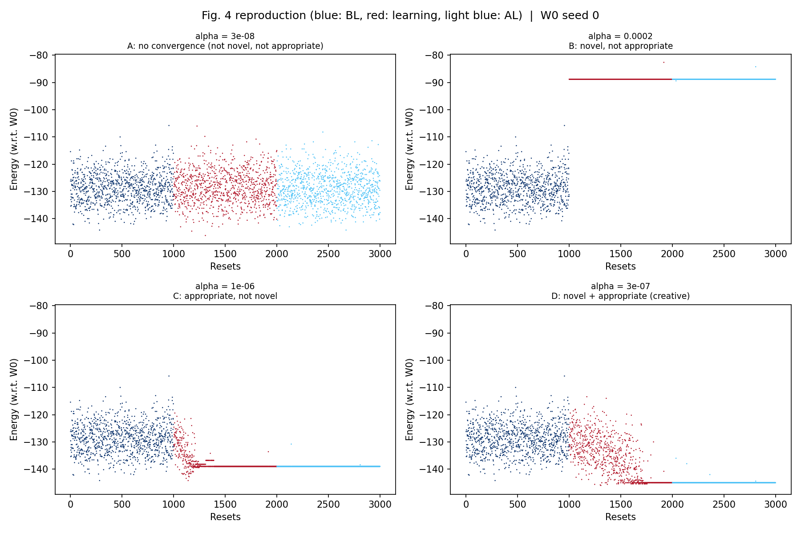
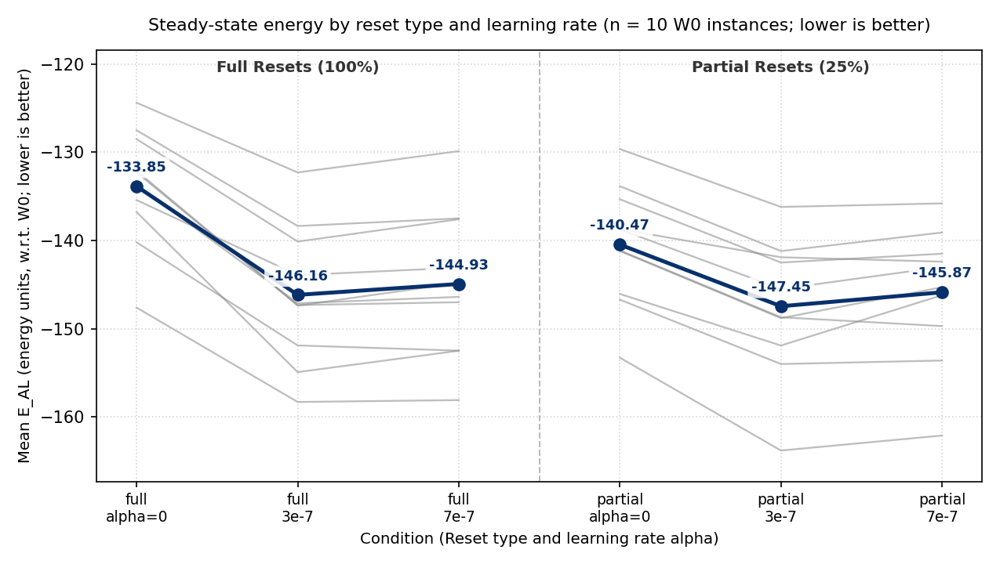
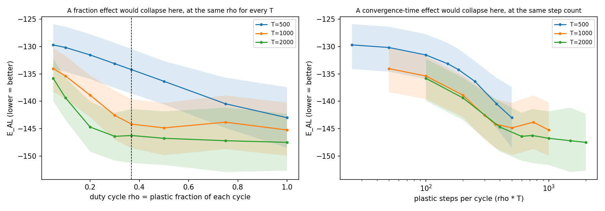
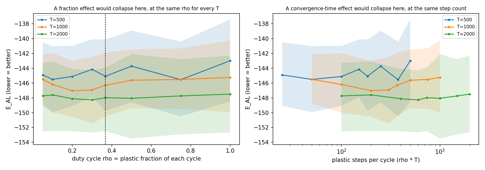
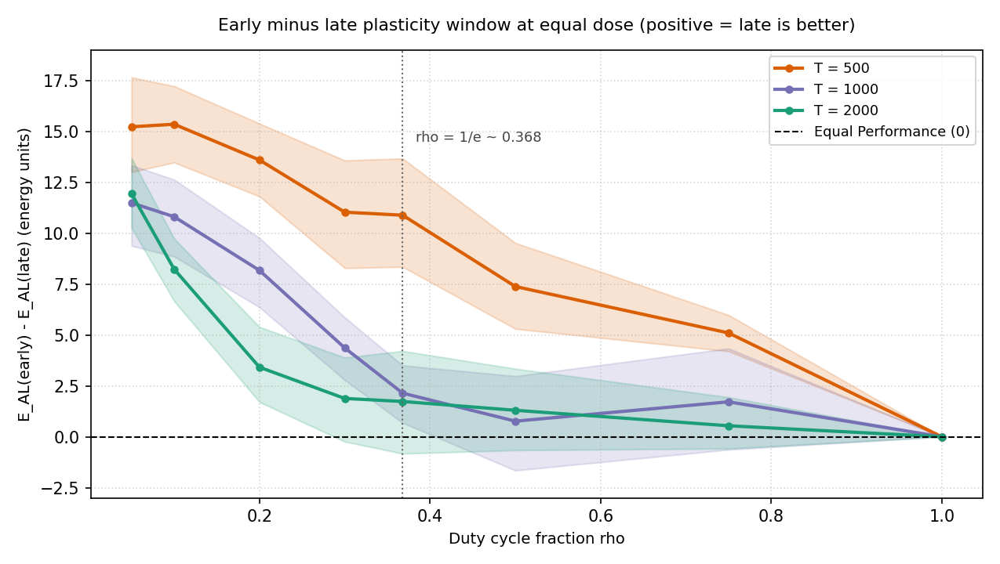

# Reproducing and Probing Self-Optimization in Hopfield Networks: A Negative-Results Report

**Authors/Replication:** Mukesh Yadav  
**Primary Reference:** Weber, Natalya, Guckelsberger, Christian, & Froese, Tom (2025). *Untapped Potential in Self-Optimization of Hopfield Networks: The Creativity of Unsupervised Learning*. Artificial Life (accepted manuscript, final author version), DOI: [10.1162/ARTL.a.10](https://doi.org/10.1162/ARTL.a.10).  

Independent work; not affiliated with OIST.

Code developed with AI assistance (Claude, Gemini); all results re-run and checked by the author.

Tested on Python 3.14.3 (other versions untested).

---

## Executive Summary
This report documents a computational replication of the self-optimization (SO) model described by Weber, Guckelsberger, and Froese (2025), followed by controlled empirical tests of two extensions:
1. **Partial State Resets:** Replacing 100% state randomizations with 25% state perturbations to test whether partial resets synergize with Hebbian learning.
2. **Duty-Cycle Hypotheses:** Testing whether restricting Hebbian plasticity to a characteristic fraction $ρ = 1/e ≈ 36.8%$ of relaxation cycles yields an interior optimization optimum.

All numerical values, test statistics, and confidence intervals reported below are directly computed from logged simulation data ($n = 10$ independent $W_0$ matrix instances, 1000 resets per phase) and can be regenerated deterministically via `make_tables.py` (fixed bootstrap seed = 0, 10,000 resamples).

---

## 1. Reproduction of Figure 4 (Weber et al., 2025)

The network model follows Section 4 and the Figure 4 protocol of Weber et al. (2025):
* $N = 100$ bipolar nodes ($s_i \in \{-1, +1\}$).
* Modular base matrix $W_0$ (Eq. 7): 20 modules of size $k = 5$. Intra-module weights are set to random $\pm 1$, and inter-module weights are set to random $\pm p$ ($p = 0.1$), symmetric, with zero diagonal.
* The plastic weight matrix $W_L$ is initialized as an exact copy of $W_0$ ($W_L \leftarrow W_0$) and serves as the only matrix in the network dynamics.
* Dynamics follow deterministic asynchronous sign updates (Eq. 1): at each step, one node $i$ is chosen uniformly at random and updated as:
  $$s_i \leftarrow \mathrm{sgn}\left(\sum_{j} W_{L,ij} s_j\right) \quad (\mathrm{with\ } \mathrm{sgn}(0) = +1)$$
* Hebbian learning (Eq. 6): after **every** asynchronous update step, the full plastic matrix is updated:
  $$W_{L,ij} \leftarrow W_{L,ij} + \alpha s_i s_j \quad (\forall i \neq j,\ \mathrm{diagonal\ remains\ } 0)$$
* Relaxation and testing: each reset interval lasts $T = 1000$ steps, after which the state vector is re-randomized while $W_L$ is preserved. Energy is evaluated at the end of each reset against the original base matrix $W_0$ (Eq. 2):
  $$E(s) = -\frac{1}{2} s^T W_0 s$$
* Protocol: three phases of $R = 1000$ resets each—Before Learning (BL, $\alpha = 0$), Learning (L, $\alpha > 0$), and After Learning (AL, $W_L$ frozen).

Simulating this protocol with 4 distinct learning rates reproduces the four qualitative dynamical regimes of Fig. 4 (single realization on seed $W_0 = 0$, identical baseline distribution across all panels with $\text{mean } E_{\text{BL}} = -128.75, \text{SD} = 5.51$, range $[-144.20, -105.80]$):

| Regime (own classification heuristic, mapped to Fig. 4 panels) | Learning Rate α | Post-Learning Mean Energy E_AL | Modal Energy | Modal State Share | Final Weight Norm ‖W_L − W₀‖_F | Description / Origin in `so_repro_results.npz` |
| :--- | :--- | :--- | :--- | :--- | :--- | :--- |
| **A: No Convergence** (not novel, not appropriate) | $3.0 \times 10^{-8}$ | $-129.07$ | $-125.00$ | $0.02$ | $0.47$ | Insufficient plastic change; post-learning energy distribution remains indistinguishable from the baseline distribution. |
| **B: Novel, Not Appropriate** | $2.0 \times 10^{-4}$ | $-88.80$ | $-88.80$ | $1.00$ | $17095.24$ | Strong plasticity locks the network into a single high-energy spurious attractor basin above the baseline energy range. |
| **C: Appropriate, Not Novel** | $1.0 \times 10^{-6}$ | $-138.99$ | $-139.00$ | $1.00$ | $69.12$ | Convergence to an attractor basin below the baseline mean, located entirely within the baseline energy range. |
| **D: Novel + Appropriate** ("Self-Optimized" / Creative) | $3.0 \times 10^{-7}$ | $-144.98$ | $-145.00$ | $1.00$ | $11.20$ | Convergence to an attractor whose modal energy ($-145.00$) is only $0.8$ units below the baseline minimum ($-144.20$) on a single $W_0$ seed; treat this classification as borderline. |



*Figure 1: Energy trajectories across Before Learning (BL, dark blue), Learning (red), and After Learning (AL, light blue) phases for learning rates alpha in {3e-8, 2e-4, 1e-6, 3e-7} on W0 seed 0, reproducing the four dynamical regimes of Figure 4 in Weber et al. (2025).*

### Methodological Observations:
* **Sensitivity to Initial W₀:** The mapping from $\alpha$ to dynamical regime depends strongly on the specific random $W_0$ instance. In the 10-instance ablation sample below, per-W₀ regime counts in the full-reset arm are:
  * At $\alpha = 3.0 \times 10^{-7}$: Regime A = 8, Regime C = 1, Regime D = 1.
  * At $\alpha = 7.0 \times 10^{-7}$: Regime C = 10, Regime A = 0, Regime B = 0, Regime D = 0.
* **Heuristic Criterion for Novelty:** Testing whether a post-learning state is "novel" by checking whether its energy falls outside the 1000-sample baseline range $[E_{\min}, E_{\max}]$ is our own empirical heuristic stand-in.

---

## 2. 2x2 Factorial Ablation: Partial vs. Full Resets

To evaluate whether partial state resets (randomly perturbing 25% of nodes at cycle boundaries) enhance self-optimization relative to standard full resets (100% randomization), we conducted a full $2 \times 2$ factorial ablation across $n = 10$ independent $W_0$ instances and 2 run seeds per cell ($N = 100, T = 1000$ steps, 1000 resets per phase):

### Cell Means across n = 10 W₀ Instances (Mean ± SD)

| Reset Mode | α | Post-Learning Energy E_AL | Minimum Energy Found E_min | Modal State Share | Weight Norm ‖W_L − W₀‖_F |
| :--- | :--- | :--- | :--- | :--- | :--- |
| **Full (100%)** | $0.0$ | $-133.85 \pm 6.70$ | $-151.14 \pm 7.42$ | $0.02$ | $0.00$ |
| **Full (100%)** | $3.0 \times 10^{-7}$ | $-146.16 \pm 7.85$ | $-151.44 \pm 7.40$ | $0.49$ | $9.15 \pm 0.94$ |
| **Full (100%)** | $7.0 \times 10^{-7}$ | $-144.93 \pm 8.38$ | $-150.88 \pm 7.40$ | $1.00$ | $41.34 \pm 4.25$ |
| **Partial (25%)** | $0.0$ | $-140.47 \pm 6.90$ | $-152.15 \pm 7.16$ | $0.02$ | $0.00$ |
| **Partial (25%)** | $3.0 \times 10^{-7}$ | $-147.45 \pm 7.88$ | $-152.12 \pm 7.19$ | $1.00$ | $27.76 \pm 2.85$ |
| **Partial (25%)** | $7.0 \times 10^{-7}$ | $-145.87 \pm 7.64$ | $-152.12 \pm 7.19$ | $1.00$ | $65.86 \pm 6.84$ |



*Figure 2: Steady-state energy E_AL across full and 25% partial reset conditions for three learning rates (alpha in {0, 3e-7, 7e-7}); grey lines show individual W0 instances and blue points indicate condition means.*

### Primary Contrasts (Paired over W₀, n = 10):
* **Baseline Reset Effect (P₀ at α = 0):**
  $$\Delta E = E_{\mathrm{AL}}(\mathrm{partial}) - E_{\mathrm{AL}}(\mathrm{full}) = -6.614$$
  Delta E = -6.614 (95% CI [-7.351, -6.014], p = 0.00195, 10/10 negative).
  *(Note: For $n = 10$ paired observations, the minimum possible two-sided Wilcoxon signed-rank $p$-value is $2 \times 0.5^{10} \approx 0.00195$.)*
  *Observation:* Even with zero learning ($\alpha = 0$), partial resets lower average steady-state energy by $6.61$ units. *(Untested hypothesis: repeated 25% perturbations may act as an iterated local search that preserves low-energy sub-basins; this mechanism was not independently tested).*
* **Learning Effects (L = E_AL(α) − E_AL(0)):**
  * At α = 3 × 10⁻⁷: Full resets drop energy by -12.311 (95% CI [-14.213, -10.465], p = 0.00195); partial resets drop energy by -6.984 (95% CI [-8.048, -5.904], p = 0.00195).
  * At α = 7 × 10⁻⁷: Full resets drop energy by -11.077 (95% CI [-12.886, -9.154], p = 0.00195); partial resets drop energy by -5.404 (95% CI [-6.831, -3.847], p = 0.00195).
* **Raw Interaction (I = L_partial − L_full):**
  * At α = 3 × 10⁻⁷: I = +5.327 (95% CI [+2.860, +7.957], p = 0.00195).
  * At α = 7 × 10⁻⁷: I = +5.673 (95% CI [+3.106, +8.686], p = 0.00391).
* **Headroom-Normalized Interaction:**
  Because partial resets start from a lower baseline at $\alpha = 0$, we normalize each arm by its available headroom:
  $$H_{\mathrm{arm}} = E_{\mathrm{AL}}(\mathrm{arm}, \alpha=0) - E_{\min}(\mathrm{arm}, \alpha=0)$$
  Fraction of available headroom achieved by learning is defined as:
  $$\mathrm{frac}(\mathrm{arm}, \alpha) = \frac{E_{\mathrm{AL}}(\mathrm{arm}, \alpha=0) - E_{\mathrm{AL}}(\mathrm{arm}, \alpha)}{H_{\mathrm{arm}}}$$
  Evaluating the paired contrast Delta_frac = frac(partial, α) − frac(full, α) via `analysis_headroom.py`:
  * At α = 3 × 10⁻⁷: Headroom achieved is 70.3% (full) vs. 61.3% (partial). Difference = -0.091 (95% CI [-0.256, +0.064]).
  * At α = 7 × 10⁻⁷: Headroom achieved is 63.2% (full) vs. 47.9% (partial). Difference = -0.153 (95% CI [-0.342, +0.016]).
  *Conclusion:* There is no evidence of synergy between partial resets and Hebbian learning; in both cases the bootstrap 95% confidence intervals include zero.

---

## 3. Duty-Cycle Probes: Evaluating the ρ = 1/e Hypothesis

Froese's framework posits that biological systems allocate effort over a canonical $≈ 37%$ fraction of a work-constraint cycle (as summarised on his OIST page; see his papers). To test whether restricting Hebbian plasticity to a fraction $\rho$ of each relaxation cycle yields an optimization optimum, we parameterized each reset cycle of length $T$ into plastic steps ($k \le \rho T$) and passive steps ($k > \rho T$).

### Protocols Tested:
1. **Cycle-Dose Rule (Early Window):** Fixed total learning dose per cycle D = α_eff × (ρT) = 7.0 × 10⁻⁴ (so α_eff = D / (ρT)). Plasticity active in the first $\rho T$ steps.
2. **Fixed-α Rule (Early Window):** $\alpha = 7.0 \times 10^{-7}$ constant; total plastic updates per cycle equal $\rho T$.
3. **Cycle-Dose Rule (Late Window):** Fixed dose $D = 7.0 \times 10^{-4}$; plasticity active only in the *last* $\rho T$ steps of the cycle.

### Key Empirical Findings:

#### 1. Absence of an Interior Optimum at ρ = 1/e
Under the cycle-dose rule with early plasticity, evaluating the paired contrast $E_{\text{AL}}(1/e) - E_{\text{AL}}(1.0)$ across all three cycle lengths from `duty_default_runs.csv`:
* **T = 500:** +8.78 (95% CI [+6.15, +11.55]) (continuous plasticity ρ = 1.0 is clearly superior to ρ = 1/e).
* **T = 1000:** +1.08 (95% CI [-0.19, +2.33]) (unresolved; 95% CI includes zero).
* **T = 2000:** +1.25 (95% CI [-1.04, +3.45]) (unresolved; 95% CI includes zero).

Across bootstrap replicates, the argmin share of $\rho = 1/e$ is $0.00$ at $T = 500$, $0.00$ at $T = 1000$, and $0.03$ at $T = 2000$.



*Figure 3: Mean post-learning energy E_AL under the cycle-dose early-window rule plotted against duty-cycle fraction rho (left) and absolute plastic steps (right) for cycle lengths T in {500, 1000, 2000}.*



*Figure 4: Mean post-learning energy E_AL under the cycle-dose late-window rule plotted against duty-cycle fraction rho (left) and absolute plastic steps (right) for cycle lengths T in {500, 1000, 2000}.*

Under the late-window rule (`duty_late_runs.csv`), E_AL is nearly flat (span 0.8-2.6 energy units); no 1/e-specific optimum; at T=500 rho=1.0 is the worst late-window setting; 1/e was not contrasted against neighbouring rho values:
* At T = 500: mean E_AL ranges from -145.55 (at ρ = 0.750) to -142.99 (at ρ = 1.000), a span of 2.55 units. Paired contrast 1/e vs 1.0 = -2.09 (95% CI [-3.88, -0.44]).
* At T = 1000: mean E_AL ranges from -147.05 (at ρ = 0.200) to -145.24 (at ρ = 1.000), a span of 1.80 units. Paired contrast 1/e vs 1.0 = -1.06 (95% CI [-2.87, +0.46]) (unresolved).
* At T = 2000: mean E_AL ranges from -148.28 (at ρ = 0.300) to -147.50 (at ρ = 1.000), a span of 0.78 units. Paired contrast 1/e vs 1.0 = -0.48 (95% CI [-2.34, +0.94]) (unresolved).

#### 2. Optimization Plateau vs. Step Count
When curves across $T \in \{500, 1000, 2000\}$ are plotted against the dimensionless fraction $\rho$, they diverge. When plotted against absolute plastic steps $S = \rho T$, the plateau begins around 400–600 plastic steps for $T = 1000$ and $T = 2000$ (read from the plot, not estimated formally), while $T = 500$ is still improving at its 500-step maximum.

#### 3. Overdose Effect at Long Plastic Windows (Fixed-α)
In the fixed-$\alpha$ arm ($\alpha = 7.0 \times 10^{-7}$), comparing longer windows to intermediate windows:
* At T = 2000: contrast ρ = 0.50 vs. ρ = 1.00 gives Delta E_AL = -2.58 (95% CI [-4.44, -0.66]), where ρ = 0.50 (1000 steps, E_AL = -146.76) achieves lower energy than ρ = 1.00 (2000 steps, E_AL = -144.18).
* At T = 1000: contrast ρ = 0.75 vs. ρ = 1.00 gives Delta E_AL = -0.79 (95% CI [-2.17, +0.60]), which is unresolved as its CI includes zero.
*(Untested hypothesis: longer plastic windows at fixed $\alpha$ may incur an overdose penalty due to cumulative weight drift; this mechanism was not independently tested).*

#### 4. Early vs. Late Plasticity Windows
Comparing early vs. late plasticity under identical cycle doses ($D = 7.0 \times 10^{-4}$, paired over $n = 10$ $W_0$ seeds):

| Cycle Length T | Fraction ρ | Early Window E_AL | Late Window E_AL | Paired Difference E_AL(early) − E_AL(late) | Bootstrap 95% CI |
| :--- | :--- | :--- | :--- | :--- | :--- |
| **T = 500** | $0.050$ | $-129.69$ | $-144.91$ | $+15.217$ | $[+12.995, +17.643]$ |
| **T = 500** | $0.100$ | $-130.17$ | $-145.51$ | $+15.342$ | $[+13.465, +17.215]$ |
| **T = 500** | $0.200$ | $-131.53$ | $-145.12$ | $+13.588$ | $[+11.797, +15.377]$ |
| **T = 500** | $0.300$ | $-133.13$ | $-144.15$ | $+11.026$ | $[+8.280, +13.568]$ |
| **T = 500** | $0.368$ | $-134.21$ | $-145.09$ | $+10.877$ | $[+8.341, +13.662]$ |
| **T = 500** | $0.500$ | $-136.34$ | $-143.72$ | $+7.376$ | $[+5.299, +9.515]$ |
| **T = 500** | $0.750$ | $-140.45$ | $-145.55$ | $+5.097$ | $[+4.197, +5.978]$ |
| **T = 500** | $1.000$ | $-142.99$ | $-142.99$ | $+0.000$ | $[+0.000, +0.000]$ |
| **T = 1000** | $0.050$ | $-134.02$ | $-145.50$ | $+11.484$ | $[+9.372, +13.331]$ |
| **T = 1000** | $0.100$ | $-135.38$ | $-146.18$ | $+10.801$ | $[+8.849, +12.623]$ |
| **T = 1000** | $0.200$ | $-138.88$ | $-147.05$ | $+8.168$ | $[+6.359, +9.761]$ |
| **T = 1000** | $0.300$ | $-142.57$ | $-146.93$ | $+4.360$ | $[+2.783, +5.858]$ |
| **T = 1000** | $0.368$ | $-144.16$ | $-146.31$ | $+2.141$ | $[+0.681, +3.503]$ |
| **T = 1000** | $0.500$ | $-144.86$ | $-145.62$ | $+0.766$ | $[-1.654, +2.978]$ |
| **T = 1000** | $0.750$ | $-143.81$ | $-145.52$ | $+1.716$ | $[-0.632, +4.336]$ |
| **T = 1000** | $1.000$ | $-145.24$ | $-145.24$ | $+0.000$ | $[+0.000, +0.000]$ |
| **T = 2000** | $0.050$ | $-135.81$ | $-147.74$ | $+11.931$ | $[+10.261, +13.677]$ |
| **T = 2000** | $0.100$ | $-139.38$ | $-147.60$ | $+8.224$ | $[+6.658, +9.729]$ |
| **T = 2000** | $0.200$ | $-144.71$ | $-148.12$ | $+3.413$ | $[+1.703, +5.392]$ |
| **T = 2000** | $0.300$ | $-146.40$ | $-148.28$ | $+1.882$ | $[-0.240, +3.888]$ |
| **T = 2000** | $0.368$ | $-146.25$ | $-147.98$ | $+1.732$ | $[-0.828, +4.212]$ |
| **T = 2000** | $0.500$ | $-146.76$ | $-148.06$ | $+1.300$ | $[-0.660, +3.340]$ |
| **T = 2000** | $0.750$ | $-147.20$ | $-147.74$ | $+0.540$ | $[-0.580, +1.940]$ |
| **T = 2000** | $1.000$ | $-147.50$ | $-147.50$ | $+0.000$ | $[+0.000, +0.000]$ |

*Window Contrast Patterns:*
* At $T = 500$: bootstrap 95% CIs exclude zero at all $\rho < 1.0$ (e.g. at $\rho = 0.05$, diff = $+15.217$ [$+12.995, +17.643$]).
* At $T = 1000$: bootstrap 95% CIs include zero for $\rho \ge 0.50$ (at $\rho = 0.50$, CI is $[-1.654, +2.978]$).
* At $T = 2000$: bootstrap 95% CIs include zero for $\rho \ge 0.30$ (at $\rho = 0.30$, CI is $[-0.240, +3.888]$).
*(Untested hypothesis: early plasticity may imprint transient states during relaxation; this mechanism was not independently tested).*



*Figure 5: Paired difference in post-learning energy between early and late plasticity windows (E_AL(early) - E_AL(late)) as a function of duty fraction rho for T in {500, 1000, 2000}, with shaded 95% bootstrap confidence bands. At rho = 1.0 the early and late windows coincide by construction, so the difference is exactly 0.*

---

## 4. Methodological Limitations

1. **Fixed Learning Rates Across Instances:** In the ablation and duty-cycle experiments, learning parameters ($\alpha$, $D$) were held fixed across all $W_0$ seeds rather than individually tuned for each matrix instance.
2. **Single Run Seed per Instance in Duty-Cycle Arms:** The duty-cycle experiments used $n = 10$ distinct $W_0$ seeds with 1 stochastic trajectory per seed ($N = 100, 1000$ resets per phase). While paired differences across $W_0$ are informative, within-instance stochastic variance was not independently averaged.
3. **Cycle-Dose Parameterization:** Under the cycle-dose rule, $\alpha_{\text{eff}} = D / (\rho T)$, which explicitly links the per-step learning rate to the window length; the observed collapse onto absolute steps is therefore partly built into the experimental design.
4. **Operational Definitions:** The concepts of "partial reset" (25% Hamming flip) and "duty cycle" (time-sliced Hebbian plasticity per reset interval) are our specific operationalizations.
5. **Theoretical Scope:** The standard self-optimization Hopfield model contains no work constraint or intrinsic cycle duration. Froese's 1/e framework is described as summarised on his OIST page: effort allocated over a canonical $≈ 37%$ fraction of a work-constraint cycle; see his papers. Therefore, tests within this discrete model do not test or contradict Froese's framework in physical or biological domains.

---

## 5. Reproduction Commands

All figures and tables can be reproduced deterministically from the repository root:

```bash
# 1. Base reproduction of Figure 4 (regimes A-D)
python so_hopfield.py --alphas 3e-8 2e-4 1e-6 3e-7 --out so_repro

# 2. 2x2 Factorial ablation (partial vs full resets x alpha)
python so_ablation.py --w-seeds 10 --run-seeds 2 --out so_ablation

# 3. Headroom-normalized ablation analysis
python analysis_headroom.py

# 4. Duty-cycle experiment (Cycle dose, early window)
python so_duty_cycle.py --dose-rule cycle --w-seeds 10 --out duty_default

# 5. Duty-cycle experiment (Cycle dose, late window)
python so_duty_cycle.py --dose-rule cycle --late --w-seeds 10 --out duty_late

# 6. Duty-cycle experiment (Fixed alpha rule)
python so_duty_cycle.py --dose-rule alpha --w-seeds 10 --out duty_alpha

# 7. Regenerate all report tables and bootstrap CIs (seed = 0, 10,000 resamples)
python make_tables.py

# 8. Generate synthesis figures (ablation_E_AL.png, early_vs_late.png; seed = 0, 10,000 resamples)
python make_figures.py
```

### Repository File Index
* `so_hopfield.py`: Deterministic asynchronous sign updates (Eq. 1) and Hebbian learning reproduction harness (Eq. 6).
* `so_ablation.py`: $2 \times 2$ ablation script testing full vs. 25% partial resets.
* `analysis_headroom.py`: Headroom-normalized analysis script evaluating synergy.
* `so_duty_cycle.py`: Duty-cycle protocol runner (early/late windows, cycle/alpha dose rules).
* `make_tables.py`: Deterministic table and bootstrap 95% CI generator script.
* `make_figures.py`: Script generating `ablation_E_AL.png` and `early_vs_late.png` with bootstrap 95% CIs.
* `duty_default_runs.csv`: Raw data for cycle-dose early-window runs ($n=10$).
* `duty_late_runs.csv`: Raw data for cycle-dose late-window runs ($n=10$).
* `duty_alpha_runs.csv`: Raw data for fixed-$\alpha$ early-window runs ($n=10$).
* `so_ablation_runs.csv`: Raw data for the $2 \times 2$ ablation factorial design.
* `so_repro_results.npz`: Trajectory and energy logs for the Figure 4 reproduction.
* `so_repro_fig4.png`: Figure 4 reproduction scatter plot across the four dynamical regimes.
* `so_repro_dW.png`: Weight norm change diagnostic plot.
* `duty_default_curves.png`: Duty-cycle early-window energy curves.
* `duty_late_curves.png`: Duty-cycle late-window energy curves.
* `duty_alpha_curves.png`: Fixed-alpha duty-cycle energy curves.
* `ablation_E_AL.png`: Steady-state energy across ablation conditions for all 10 W₀ instances.
* `early_vs_late.png`: Paired contrast curves between early and late plasticity windows.
* `LICENSE`: MIT License.
